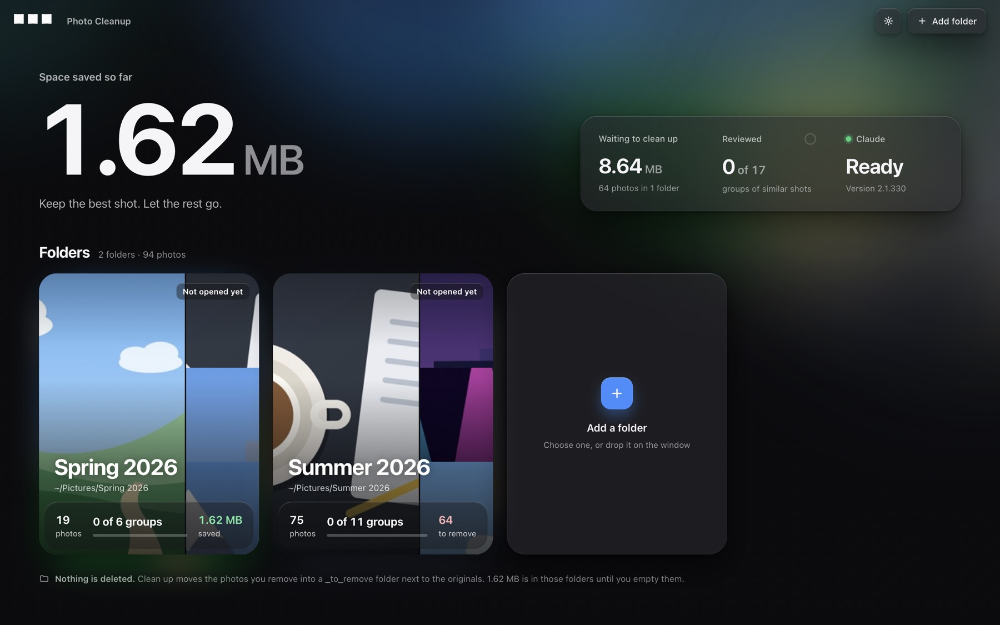
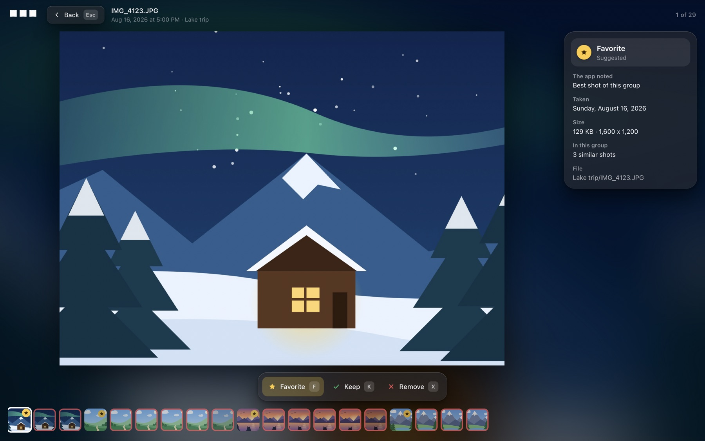
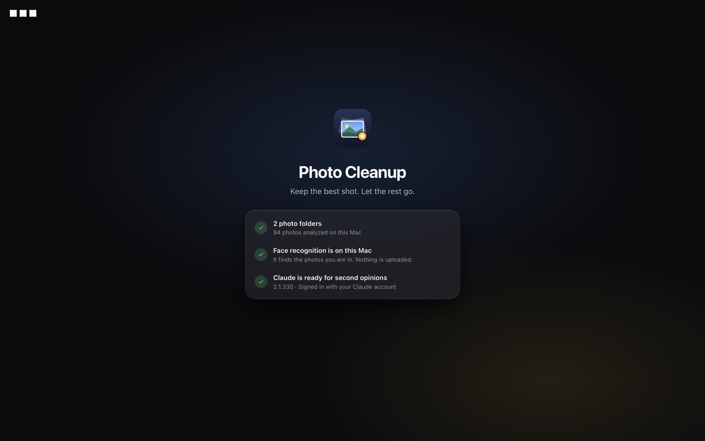

<div align="center">

  

  <h1>Photo Cleanup</h1>

  <p><b>Keep the best shot. Let the rest go.</b></p>

  <p>
    A free, open-source Mac app that finds the near-identical shots in a photo folder,<br/>
    picks the best one of each group, and lets you review every decision.<br/>
    Nothing is deleted, and every step has an undo.
  </p>

  <p>
    <a href="https://github.com/Krutik460/photo-cleanup/releases/latest"></a>
    <a href="https://github.com/Krutik460/photo-cleanup/releases"></a>
    <a href="#install"></a>
    <a href="LICENSE"></a>
    <a href="https://github.com/Krutik460/photo-cleanup/stargazers"></a>
  </p>

  <p>
    <a href="https://github.com/Krutik460/photo-cleanup/releases/latest"><b>Download</b></a>
    &nbsp;·&nbsp;
    <a href="#install">Install</a>
    &nbsp;·&nbsp;
    <a href="#what-it-does">Features</a>
    &nbsp;·&nbsp;
    <a href="#private-by-default">Privacy</a>
    &nbsp;·&nbsp;
    <a href="#development">Build from source</a>
  </p>

  

</div>

---

You took the same photo nine times. Photo Cleanup groups the look-alikes, suggests the one to keep and
says why, and you go through them with four keys. When you are done, the photos you removed move into
a `_to_remove` folder inside your photo folder. You delete that folder yourself, when you are sure.

> [!NOTE]
> Nothing is ever deleted. Files only move in the two steps of Finish, each asked first and each with
> its own undo: **Organize files** puts a collection's photos into a folder of their own, and
> **Clean up** puts the photos you marked remove into `_to_remove`.

<p align="center">
  <a href="docs/assets/demo.mp4"></a><br/>
  <sub>Twenty seconds of Photo Cleanup. <a href="docs/assets/demo.mp4">Watch it with sound.</a> The pictures in it are drawn for the video.</sub>
</p>

## What it does

### Home

The space your clean-ups have saved, what is waiting, and every photo folder as a card. Click one to
open it, or drop a folder on the window to add it. Removing a folder from the app sends only the
app's data about it to the Trash; the photos stay.

<p align="center">
  
</p>

### Organize

Your photos sorted into trips, day trips, events and everyday months, each as a cover. A folder
directly inside your photo folder is a collection as it is, named after the folder.

- Select several collections to merge them, or let the app suggest it when two trips touch.
- Rename a collection in place, mark a trip that is not one, or give a collection a folder of its own.
- Search, and filter by kind.

<p align="center">
  
</p>

### Review

Each group of similar shots with its best one large, and the reason for the pick.

| Key | What it does |
| --- | --- |
| `F` | Favorite. The shot takes the large place in its group |
| `K` | Keep |
| `X` | Remove |
| `U` | Back to the suggestion |
| `D` | Mark the group reviewed and go to the next one |
| `S` | Select photos, to move them to another collection |
| `Return` | Open the photo large |
| `?` | All keys |

A photo marked remove keeps its real look and gets a red frame, so you judge what you see. Reviewed
groups fold away.

<p align="center">
  
</p>

### Finish

Two steps that move files. **Organize files** moves each switched-on collection into a folder named
after it. **Clean up** moves the photos marked remove into `_to_remove`; exact duplicate copies can
go first. Each step asks in place and has its own undo.

<p align="center">
  
</p>

### Photos of you

Give the app one to three clear photos of you (when adding a folder, or later under Library > Photos
of you). It then knows which shots you are in, never suggests removing one of them on its own, and
keeps the best of them. The comparison runs on your Mac.

### Second opinion

Optional. The sparkles button asks Claude which shots of each group to keep, and why. It runs your own
installed [Claude Code](https://claude.com/claude-code) command with your sign-in; no API key is stored
in the app. When the command is missing or signed out, the app shows the two Terminal lines to set it
up. Your own choices always win over its picks.

### Light and dark

The app follows the system appearance.

<p align="center">
  
</p>

## Install

1. Download `Photo-Cleanup-<version>.dmg` from the
   [latest release](https://github.com/Krutik460/photo-cleanup/releases/latest), open it and drag Photo Cleanup to
   Applications.
2. The app is not notarized by Apple, so the first launch is stopped with "Apple could not verify".
   Open System Settings > Privacy & Security, scroll to the message about Photo Cleanup and click
   **Open Anyway**. That is needed once.

Needs macOS 15 or later, Apple silicon or Intel.

<p align="center">
  
</p>

## Private by default

- Similar shots, sharpness, faces, trips and events are all worked out on your Mac. No account, no
  telemetry, and the app never listens on a network port.
- The app's data about a folder lives in `~/Library/Application Support/Photo Cleanup/`. Your photos
  are only read, until you ask for one of the two steps in Finish.
- The only thing that can leave the Mac is the optional second opinion: small contact sheets of the
  groups go to Anthropic through your own Claude Code command. File names, locations and face data
  stay on the Mac.

## How it works

| Step | Where | Runs |
| --- | --- | --- |
| Analyze every photo: similarity embedding, face quality, aesthetic score, sharpness, capture time, GPS, thumbnail | `Core/.../Analyzer` (Apple Vision) | on device |
| Find the photos you are in: aligned face crops, SFace embeddings against your photo of you | `Core/.../Faces` (Core ML) | on device |
| Detect trips, events and everyday months; group similar shots; pick a favorite with a reason | `Core/.../Grouping` | on device |
| Second opinion on each group, from one numbered contact sheet per group | `Core/.../Review` + the Claude CLI | Anthropic, through your CLI |
| Your choices, names, merges and moves; organize, clean up, undo | `Core/.../Catalog` | on device |

### Cleanup policy

- Photos with you: never suggested for removal on their own. In a group, the best shot of you is the
  favorite and one more good, clearly different shot of you is kept.
- Photos without you: a group keeps only its single best shot; near-repeats anywhere in the same trip
  or event are grouped; singles are suggested for removal when blurry, a screenshot or document, or in
  the bottom 35% by quality.
- A photo's state is, in order: your choice, else Claude's pick, else the on-device pick.

### Where things are kept

Each photo folder has a library in `~/Library/Application Support/Photo Cleanup/Libraries/<id>/`:
`library.sqlite` (everything known and decided about the photos) plus thumbnails and previews, which
can always be rebuilt. A photo is a row in that database, not a path: moving or renaming a file, in
the app or in Finder, keeps everything decided about it. Every file the app moves is written to the
`file_move` table before it moves, so a crash mid-step cannot lose track of a file.

## Development

To build the DMG yourself:

```bash
scripts/make-dmg.sh
```

On its first run this fetches the face model (SFace from OpenCV's model zoo, 37 MB) and converts it to
Core ML, then builds `dist/Photo-Cleanup-<version>.dmg` (Apple silicon and Intel), signed with the
Apple Development identity on your Mac when there is one. `scripts/make-dmg.sh --public` builds the
download as it is released: signed ad hoc. Building needs Xcode, `xcodegen` and `uv`.

```
Core/            Swift package PhotoCleanupCore with all logic, and photocleanup-cli
MacApp/          the Mac app: one window with a web view, menus, pickers, drag and drop, Settings
ui/              the whole interface (HTML, CSS, JS, no build step), served through photocleanup://
app/             the review page of the earlier scripts (server.py); the app does not use it
scripts/         make-dmg.sh, make-icon.swift, convert_face_model.py, app-shot.sh
project.yml      XcodeGen project (the .xcodeproj is generated, not committed)
```

```bash
swift test --package-path Core
```

```bash
xcodegen generate && xcodebuild -project PhotoCleanup.xcodeproj -scheme PhotoCleanup -derivedDataPath build/DerivedData build
```

The interface is one page. What it shows above a single folder (the folders, scanning, Claude, the
second opinion) comes from `Workspace` in the core and is answered by `AppRouter` under `/app/*`;
everything about the open folder is answered by its `Router` under `/api/*`. The Mac app feeds both
from a custom URL scheme and adds what only a Mac app can do (pickers, Finder, Settings, moving the
window from the page's own toolbar).

`Core/.build/debug/photocleanup-cli` drives the core without the app: `analyze`, `second-opinion`,
`import-review`, `summary`, `clean-up`, `undo-clean-up`, and `serve`:

```bash
Core/.build/debug/photocleanup-cli serve <libraries-dir> ui 8770 --model models/SFace.mlmodelc
```

puts the whole interface on localhost for work in a browser (no pickers there: a folder is added with
`appAction('add', {path: '...'})` in the console). `scripts/app-shot.sh` launches the debug build and
saves a picture of its own window, for checking the UI without recording the screen; the variables it
takes are listed in `MacApp/DebugAutomation.swift`, and `PHOTOCLEANUP_UI=ui` reads the interface from
the source folder, so a change needs no rebuild. Those pictures do not show the blur behind glass.

`PHOTOCLEANUP_PARITY_DIR=<folder> swift test --package-path Core --filter GroupingParityTests`
compares the Swift grouping with `group.py` on a folder holding that script's input and output.

## The earlier scripts

The repository still holds the scripts the app replaces (`run.sh`, `analyze.swift`, `group.py`,
`faces.py`, `prepare_review.py`, `merge_review.py`, `server.py`). They keep their state as JSON files
in an output folder. File > Import Review from the Old Scripts brings such a folder's choices,
reviewed marks, picks, names and collection edits into the open library, matching photos by where
they are now.

## What the app ships with

- **SFace**, the face recognition model, from [OpenCV's model zoo](https://github.com/opencv/opencv_zoo/tree/main/models/face_recognition_sface) (Yaoyao Zhong and others), under the Apache License 2.0: `licenses/SFace-LICENSE.txt`. The app carries it converted to Core ML; the weights are unchanged.
- **GRDB.swift** for SQLite, under the MIT license: `licenses/GRDB-LICENSE.txt`.

## License

Photo Cleanup is released under the [MIT License](LICENSE). The face model and GRDB keep their own licenses, listed above.
