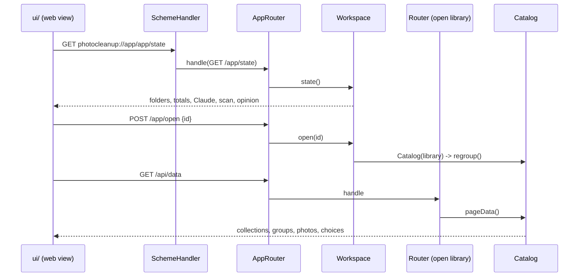
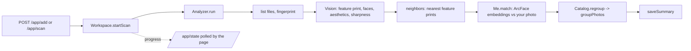
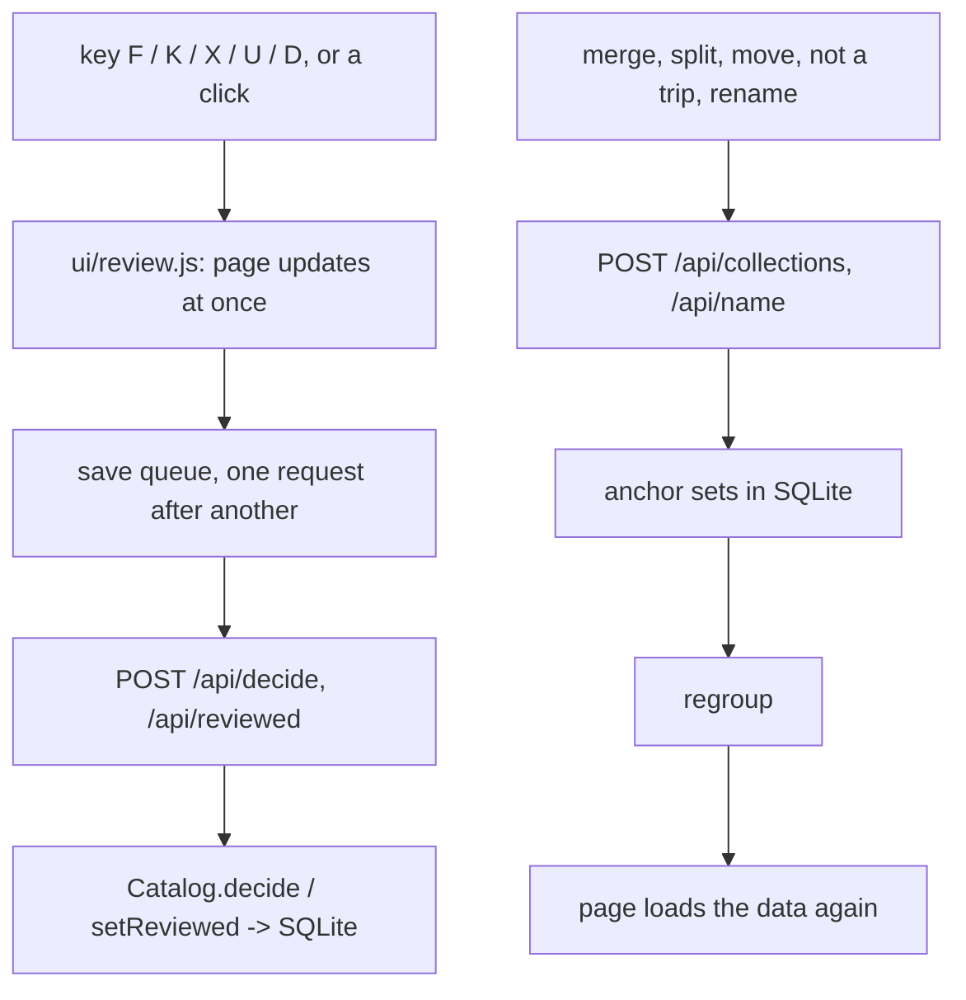
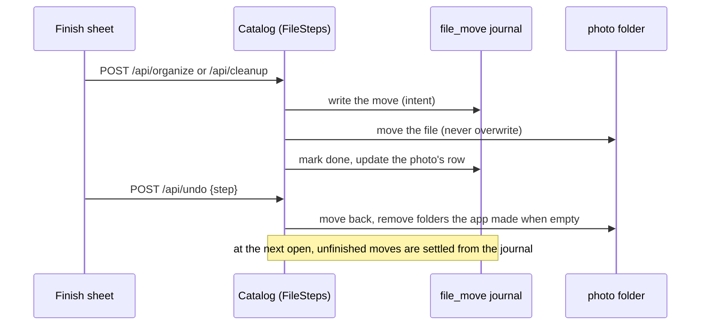
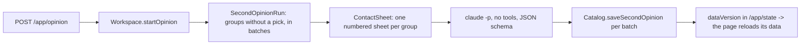

# PR 1: Photo Cleanup as a Mac app (`mac-app`)

## Core changes

- **A Swift core** (`Core/`, package `PhotoCleanupCore`) replaces the scripts' pipeline: analysis
  (Apple Vision), faces (Core ML), grouping, the catalog in SQLite, file steps, second opinion, and an
  importer for a review done with the scripts. `photocleanup-cli` drives it without the app.
- **A photo is a database row, not a path.** Each photo folder has a library
  (`library.sqlite` + thumbnails) in Application Support. Files moved in Finder are found again by a
  content fingerprint, so choices survive.
- **The app is one web page in a native window** (`MacApp/` + `ui/`). The page asks, the core answers,
  through a custom URL scheme. Nothing listens on a network port.
- **Two routers.** `AppRouter` answers `/app/*` from a `Workspace` (folders, scanning, Claude, second
  opinion) and passes everything else to the open library's `Router` (`/api/*`, images).
- **File steps are journaled.** Every move is written to `file_move` before it happens and settled at
  the next open, each step has its own undo, and nothing is overwritten or deleted.
- **Sub folders are collections.** A folder directly inside the photo folder is one collection, named
  after it; its photos stay out of trip and event detection.
- **Public download.** `scripts/make-dmg.sh --public` builds the DMG that is released: signed ad hoc,
  with a face model whose license allows shipping it (SFace, Apache 2.0).

## Entry point: opening the app and a folder

- [MacApp/PageView.swift](../../MacApp/PageView.swift): the web view, the `in-app` marker, folder drops.
- [MacApp/SchemeHandler.swift](../../MacApp/SchemeHandler.swift): requests off the main thread, answers on it.
- [Core/Sources/PhotoCleanupCore/App/AppRouter.swift](../../Core/Sources/PhotoCleanupCore/App/AppRouter.swift),
  [Workspace.swift](../../Core/Sources/PhotoCleanupCore/App/Workspace.swift): what is above one library.
- [Core/Sources/PhotoCleanupCore/Catalog/Router.swift](../../Core/Sources/PhotoCleanupCore/Catalog/Router.swift): one library's requests; `/thumb` (480 px), `/mid` (1,280 px, cached), `/full`.
- [ui/main.js](../../ui/main.js): routes `#home`, `#<folder>/organize`, `#<folder>/c/<id>`, `#<folder>/view/<name>`.

Decisions:

- The interface is a web page because the chosen design ("Glass workspace") was approved as an HTML
  mockup; the same CSS runs in the app, so the result matches what was picked.
- Going home closes the folder, which saves its summary for the home screen. The home screen never
  regroups a library to show its numbers.
- The page draws its own toolbar, so it tells the app when a press there should move the window
  (`POST /app/window`). The traffic lights are moved to where the page leaves room and put back
  whenever AppKit lays the title bar out again ([MacApp/RootView.swift](../../MacApp/RootView.swift)).
- The same `AppRouter` runs behind `photocleanup-cli serve`, so the interface is developed in a browser.

## Entry point: scanning a folder

- [Core/Sources/PhotoCleanupCore/Analyzer/](../../Core/Sources/PhotoCleanupCore/Analyzer/): incremental; only new, changed or moved files are analyzed.
- [Core/Sources/PhotoCleanupCore/Faces/](../../Core/Sources/PhotoCleanupCore/Faces/): optional; without the model photos of you are not picked out.
- [Core/Sources/PhotoCleanupCore/Grouping/](../../Core/Sources/PhotoCleanupCore/Grouping/): a pure function; same results as `group.py`.

Decisions:

- The face model is SFace from OpenCV's model zoo (Apache 2.0), run through Core ML. It is fetched
  and converted from ONNX by `scripts/convert_face_model.py`, which checks the result against the
  original. The scripts' model (InsightFace ArcFace) may not be passed on, so the app does not use it.
  On 2,374 real face crops SFace and ArcFace disagreed on 4; on the 120 sample photos they pick the
  same 19 photos of the owner. A library analyzed with the earlier model re-analyzes itself when
  opened, and its reference photo of you is embedded again.
- A photo moved by hand keeps its row: an in-place photo takes the new path as its home; a filed or
  removed one keeps its original home, so undo still works.
- A folder directly inside the photo folder is taken out of the timeline and becomes one collection
  (`GroupingPhoto.folder`, `GroupedCollection.sourceFolder`). Its kind follows from its photos. It
  uses `original_rel_path`, so folders the app made do not turn into new collections.

## Entry point: reviewing (choices, names, merges)

- [ui/review.js](../../ui/review.js), [ui/folder.js](../../ui/folder.js), [ui/viewer.js](../../ui/viewer.js).
- [Core/Sources/PhotoCleanupCore/Catalog/Catalog.swift](../../Core/Sources/PhotoCleanupCore/Catalog/Catalog.swift),
  [Edits.swift](../../Core/Sources/PhotoCleanupCore/Catalog/Edits.swift).

Decisions:

- A photo's state is your choice, else Claude's pick, else the on-device suggestion. Only choices that
  differ from the suggestion are stored.
- Edits are stored as sets of photos ("anchor sets") and apply to the collection holding most of them
  now, so they survive rescans and regrouping. Collections and groups are derived in memory.
- A group has one favorite: starring another shot turns the earlier one into a keep.
- Photos marked remove are never dimmed. They keep their real look and get a red frame.

## Entry point: Finish (organize files, clean up, undo)

- [Core/Sources/PhotoCleanupCore/Catalog/FileSteps.swift](../../Core/Sources/PhotoCleanupCore/Catalog/FileSteps.swift),
  [ui/finish.js](../../ui/finish.js).

Decisions:

- Nothing is deleted. Clean up moves files to `_to_remove` inside the photo folder, keeping subfolders.
- Only folders the app made are removed when they empty. A name clash gets " (2)".
- Organize skips a photo that already is in its folder, or deeper inside it, and sends a photo home
  instead of filing it when home is inside the target folder (a renamed folder of yours taken back).
- Tested on real files in a temporary directory and end to end on a scratch copy: after both undos
  the folder holds the same files as before.

## Entry point: second opinion

- [Core/Sources/PhotoCleanupCore/Review/](../../Core/Sources/PhotoCleanupCore/Review/),
  the panel in [ui/shell.js](../../ui/shell.js).

Decisions:

- The app runs the user's installed `claude` command with their sign-in; no API key is stored. When
  the command is missing or signed out, the app shows the Terminal commands and copies them; it never
  runs an installer.
- The model gets no tools and only sees contact sheets. File names, locations and face data stay on
  the Mac.
- Picks are saved batch by batch, so a stopped run keeps what it finished.
