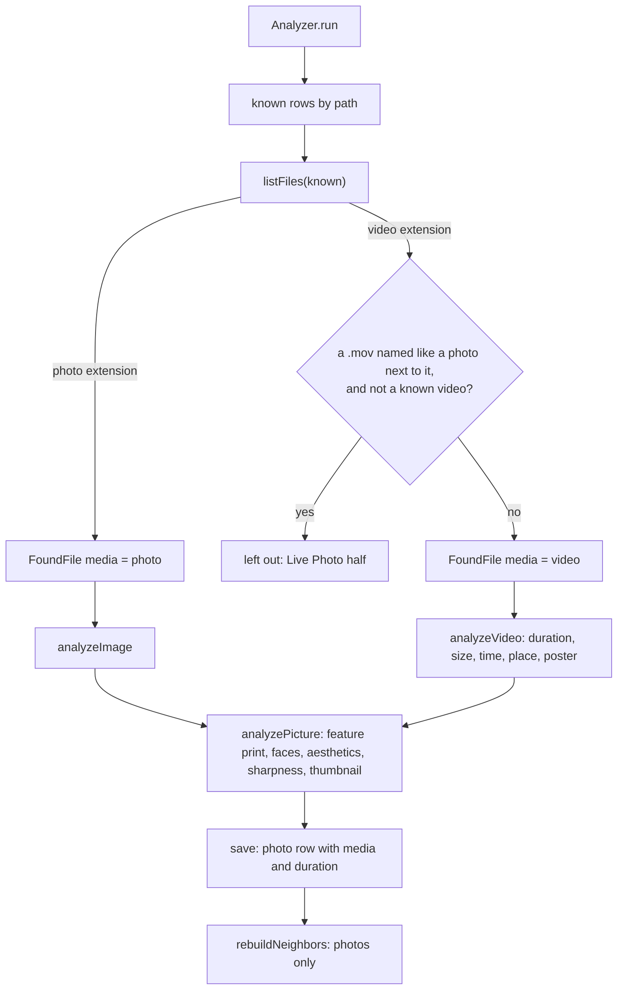
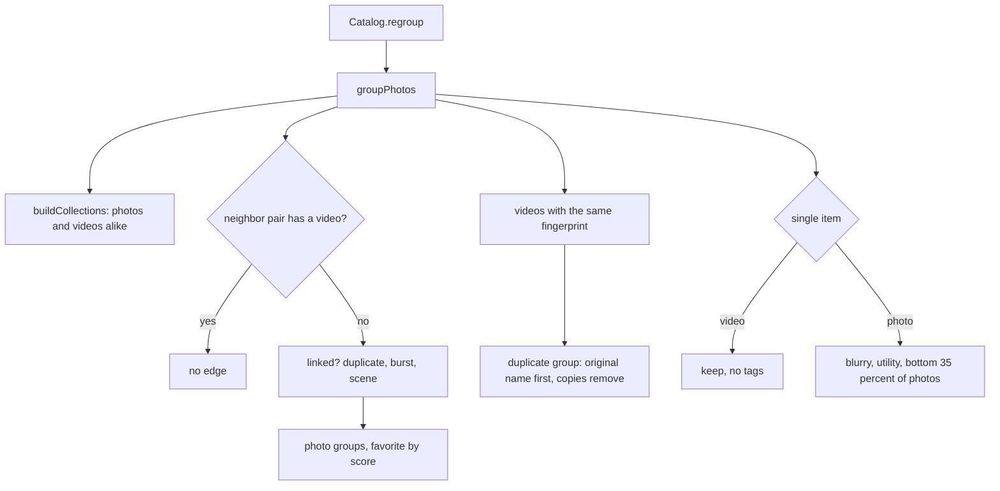
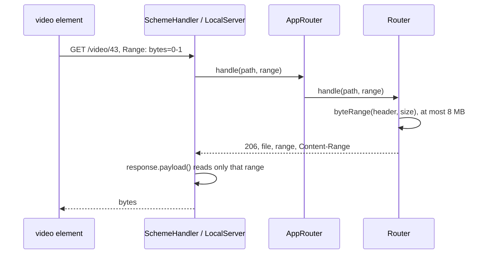
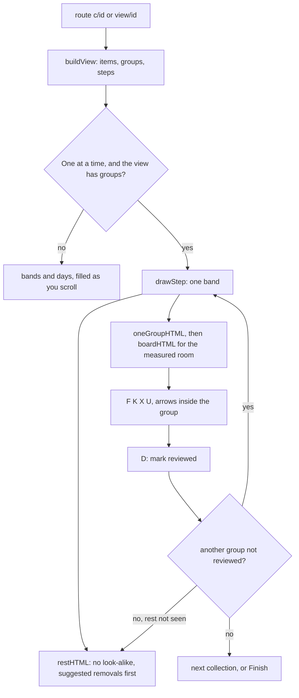
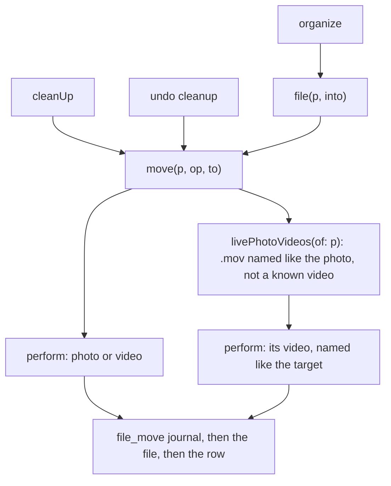
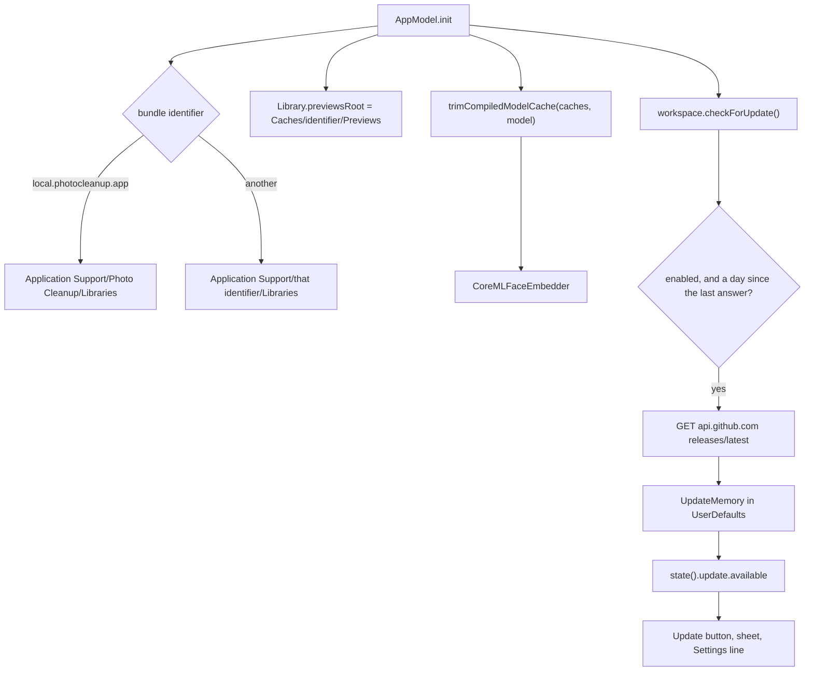

# PR 2: Videos, review one group at a time, update check (`videos-and-group-review`)

## Core changes

- **A video is an item like a photo.** One row in `photo` (new columns `media`, `duration`), the
  same identity, the same file steps. It is analyzed as what its file says (length, size, when and
  where) plus one poster frame that goes through the same Vision steps as a photo.
- **Only exact copies of a video are grouped.** A video never groups with a photo or with another
  take, and a video on its own is never suggested for removal.
- **A video is served in the bytes asked for.** `GET /video/<id>` answers `Range` requests; the web
  view plays it through the app's own URL scheme. `/mid` and `/full` of a video are its poster.
- **Review shows one group per screen.** The favorite large, the others laid out for the room there
  is, a tick per group, `D` for reviewed and next, then the photos with no look-alike. The page of
  all groups stays, behind a switch.
- **One routine moves a file with its Live Photo video.** Organize, clean-up and both undos use it.
  Clean-up used to leave the video half behind.
- **Update check.** One anonymous request to GitHub a day, an Update button when a newer release
  exists, a switch in Settings.
- **Caches stop growing.** Core ML's compiled-model cache is emptied when it holds more than the
  one copy in use; previews live in the caches folder.
- **A copy under another bundle identifier is its own app.** Its libraries, caches and settings
  never touch the installed app's.

## Entry point: scanning a folder

- [Analyzer.swift](../../Core/Sources/PhotoCleanupCore/Analyzer/Analyzer.swift): `listFiles` lists both kinds and applies the Live Photo rule; `save` writes `media` and `duration`; `ScanSummary.analyzedVideos`.
- [VideoAnalysis.swift](../../Core/Sources/PhotoCleanupCore/Analyzer/VideoAnalysis.swift): `analyzeVideo`, the poster frame, capture time and place, `isLivePhotoVideo`.
- [ImageAnalysis.swift](../../Core/Sources/PhotoCleanupCore/Analyzer/ImageAnalysis.swift): `analyzeImage` split into reading the file and `analyzePicture`, shared with videos.
- [Neighbors.swift](../../Core/Sources/PhotoCleanupCore/Analyzer/Neighbors.swift): videos are left out of the similarity index.
- [Store.swift](../../Core/Sources/PhotoCleanupCore/Store/Store.swift): migration `v6 videos`.

Key decisions:

- The table keeps the name `photo`. A rename would touch every query and change no behavior.
- Capture time is kept as a wall clock, like a photo's EXIF time. An iPhone writes the local time
  with its offset (`com.apple.quicktime.creationdate`): the offset is dropped on purpose. A file
  that only has an instant is shown in the Mac's time zone.
- The poster is taken one second in (half way for a clip under two seconds): the first frame is
  often black.
- A video the library already knows at its path is never taken for a Live Photo half. Without
  that, a video filed next to a photo of the same name (`IMG_5.jpg`, `IMG_5.mov` from two cameras)
  would vanish at the next scan.
- Known limit: on a first scan, a long video named exactly like a photo next to it counts as that
  photo's Live Photo half, as before.

## Entry point: regrouping

- [Grouping.swift](../../Core/Sources/PhotoCleanupCore/Grouping/Grouping.swift): the video branch, `originalFirst` shared by photos and videos.
- [GroupingTypes.swift](../../Core/Sources/PhotoCleanupCore/Grouping/GroupingTypes.swift): `GroupingPhoto.video`, `.fingerprint`.
- [Catalog.swift](../../Core/Sources/PhotoCleanupCore/Catalog/Catalog.swift): passes both; `pageData` adds `dur` for a video.
- [Summary.swift](../../Core/Sources/PhotoCleanupCore/Catalog/Summary.swift): `videos` counted apart; a summary stored by an earlier version still decodes.

Key decisions:

- The owner chose "exact copies only". Similar takes are not grouped: two takes are not
  interchangeable the way burst shots are. The poster's feature print is stored anyway, so that
  choice can change later without a rescan.
- Copies are found by fingerprint (size plus a hash of the first and last 64 KB), not by picture
  similarity.
- Videos are left out of the quality percentile of photos, and are never tagged blurry: one frame
  says too little.
- A video group has kind `duplicate`, so "Remove duplicate copies" in Finish and the second
  opinion's "skip duplicates" apply to it with no extra code.

## Entry point: a request of the page for a video

- [Router.swift](../../Core/Sources/PhotoCleanupCore/Catalog/Router.swift): `/video/`, `byteRange`, `RouterResponse.range`, `payload()`, `headers(length:)`, posters in `preview`.
- [AppRouter.swift](../../Core/Sources/PhotoCleanupCore/App/AppRouter.swift): passes `range` on.
- [SchemeHandler.swift](../../MacApp/SchemeHandler.swift), [LocalServer.swift](../../Core/Sources/photocleanup-cli/LocalServer.swift): read the `Range` header, send what `payload()` gives.

Key decisions:

- Measured before building: WebKit plays a clip through a custom scheme with about 300 small
  ranges (largest 98 KB), H.264 and HEVC alike. No native player was needed.
- A reply carries at most 8 MB. A browser that asks for "the rest" gets a part and asks again, so a
  long video is never held in memory.
- The reading and the headers live in `RouterResponse`, so the app and the development server
  cannot drift apart.

## Entry point: Review (`ui/review.js`)

- [review.js](../../ui/review.js): `oneMode`, `steps`, `drawStep`, `boardHTML` and `justify`, `paintTicks`, `goStep`, `stepGroup`, `setReviewMode`; `tile` with the play mark.
- [viewer.js](../../ui/viewer.js): painted in parts, so a choice never restarts a video; steps through the shots on screen.
- [ui.css](../../ui/ui.css): the last three sections.
- [core.js](../../ui/core.js): `isVideo`, `clock`, `mixed`, `countOf`, `files`, `tally` with videos.

Key decisions:

- The owner chose "side by side, favorite first and larger" over one shot at a time.
- One at a time draws the same view model as All, one item instead of all. `#bands` holds the one
  band, so tiles, selection, choices and the viewer need no second code path.
- The board is computed, not flowed: every split and row count is tried, and the one that shows
  the other shots largest wins while the favorite is still 1.25 (two shots) to 1.5 times higher.
- The mode is remembered (`localStorage`), and applies to the library views that list groups.
- The folder switch and the "includes photos from" notes are on the All page and in the menu: one
  group has to fit the window.
- Removed photos keep their real look (red frame), as before.

## Entry point: Organize files, Clean up, Undo

- [FileSteps.swift](../../Core/Sources/PhotoCleanupCore/Catalog/FileSteps.swift): `move`, `livePhotoVideos`, the companion row that is dropped when its video is back in place.

Key decisions:

- Clean-up moves the Live Photo video with its photo. Left behind it wasted the space, and the
  next scan would have listed it as a video of its own.
- Where the video comes back to on undo is worked out from where its photo goes (same folder, same
  name), not stored.
- A video item is never its own companion, and never anyone else's: the library's video rows are
  checked.

## Entry point: launching the app

- [AppModel.swift](../../MacApp/AppModel.swift): the wiring; [SettingsView.swift](../../MacApp/SettingsView.swift): the Updates section.
- [UpdateCheck.swift](../../Core/Sources/PhotoCleanupCore/App/UpdateCheck.swift): versions, GitHub's reply, the once-a-day rule, `trimCompiledModelCache`.
- [Workspace.swift](../../Core/Sources/PhotoCleanupCore/App/Workspace.swift): `checkForUpdate`, `update-check`, `update-open`, `state()["update"]`.
- [Library.swift](../../Core/Sources/PhotoCleanupCore/Store/Library.swift): `previewsRoot`; previews kept with a library by an earlier version are removed.
- [shell.js](../../ui/shell.js): `paintUpdate`, `openUpdate`.

Key decisions:

- The app does not replace itself. It is not notarized, so the button opens the download and says
  what macOS will ask.
- Links from GitHub's reply are opened only when they are https links to github.com.
- A failed check is not counted as a check: what was known stays, and the next launch asks again.
- Measured: Core ML writes a 37 MB compiled copy of the model per place the model was loaded from,
  whatever the compute units, and never removes one. The cache is emptied when it holds more than
  one and a half times the model; the copy in use is made again in about a tenth of a second.
- Thumbnails stay with the library (they stand in while a drive is away); previews are caches.
- The command line tool has no version and no update check.
